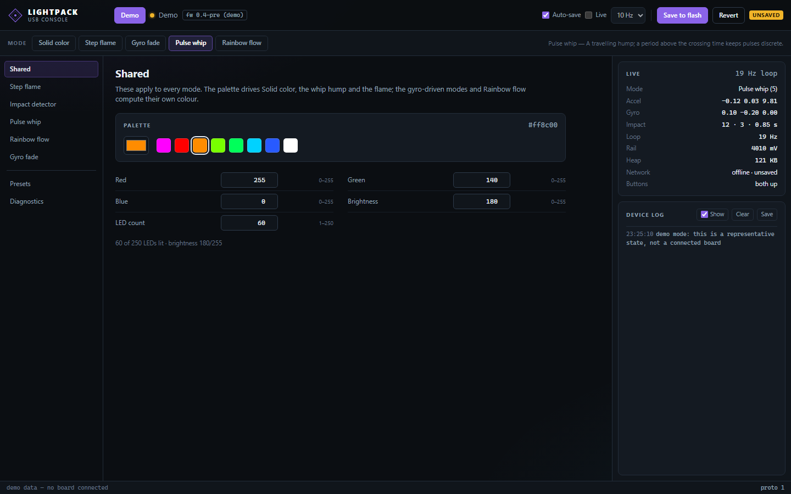

# Lightpack USB console

A zero-install browser page for tuning the lamp over the C3's USB cable. No
Python, no Node, no driver, no build step: one URL, Chrome or Edge, and the
board.

It exists because the ceramic antenna is not always able to carry a
configuration session. This page never needs WiFi; it works with the radio
switched off, and it keeps working while the board is stuck in its 60-second
configuration hotspot.



---

## 1. Requirements

| Requirement | Detail |
|---|---|
| Browser | **Chrome or Edge, desktop.** Web Serial is a Chromium API; Firefox, Safari and every mobile browser lack it. Chrome/Edge 89 or newer. |
| Page origin | **`https://` or `localhost`.** Both are secure contexts. A plain `http://192.168.x.x` address is not, and `file://` is refused outright. |
| Cable | A **data** USB-C cable. Charge-only cables enumerate nothing. |
| Driver | None on Windows 10+, macOS, or Linux with the usual `dialout`/udev access. The C3's USB is native CDC. |
| Port | The page must be the only program holding it. Close PlatformIO's monitor, the Arduino IDE, PuTTY or the browser installer before connecting. |

The board appears as **USB Serial/JTAG** (Espressif `303A:1001`) and the browser
asks which port to open. It does not need to be in download mode.

---

## 2. Open it

### Published (normal case)

If GitHub Pages is enabled for the repository (see
[`install/README.md`](../../../install/README.md)), the console is at:

```
https://machadoleonardo94.github.io/lux-et-tenebris/Firmware/lightpack-C3/console/
```

That is the zero-install path: send the URL, plug the board in, click Connect.

### Locally

Serve the **repository root**, not this folder, because the page's help links
reach into the repository:

```bash
# from the repository root: C:\Github\lux-et-tenebris
python -m http.server 8000
```

then open:

```
http://localhost:8000/Firmware/lightpack-C3/console/
```

If you start the server inside the firmware folder instead
(`C:\Github\lux-et-tenebris\Firmware\lightpack-C3`), the prefix goes away:

```bash
# from Firmware/lightpack-C3
python -m http.server 8000
```

```
http://localhost:8000/console/
```

The URL has to match the server's working directory. Serving the firmware
folder and asking for `/Firmware/lightpack-C3/console/` is a 404, and serving
the repository root and asking for `/console/` is a 404 too — neither is a
browser or Web Serial problem.

Any static server works (`npx serve .`, `php -S localhost:8000`). Opening
`index.html` straight off disk will not work — Web Serial is not exposed to
`file://`, and the page says so instead of failing silently.

### Demo

`?demo` draws a representative board state with no connection; the controls are
inert because there is no board behind them:

```
http://localhost:8000/Firmware/lightpack-C3/console/?demo
```

If the server is running inside `Firmware/lightpack-C3`, use
`http://localhost:8000/console/?demo`.

`&page=flame`, `&page=impact`, `&page=presets`, … opens a specific page. This is
what the screenshot above uses.

---

## 3. Using it

1. Plug the board in.
2. Click **Connect** and choose the port. The page sends `PING`, reads the mode
   registry, the live configuration and the preset slots.
3. The **mode bar** is live: clicking a mode changes the strip immediately (and
   auto-saves, if that is on).
4. The **left pages** group the tunables by the mode that consumes them:
   * Shared — palette, brightness, LED count;
   * Step flame — the flash/decay values and the impact preview;
   * Impact detector — threshold, release, jerk gate, refractory, scale;
   * Pulse whip, Rainbow flow — their tunables;
   * Gyro fade — no tunables, by design;
   * Presets, Diagnostics.
5. **Save to flash** persists the live configuration. **Revert** discards unsaved
   edits and reloads NVS.
6. **Auto-save** (default on) writes once, about a second after the last edit, so
   a slider drag is one flash transaction rather than one per keystroke. Turn it
   off for a session where you want to try things and discard them.
7. **Live** asks the board for telemetry at 5/10/20/50 Hz. The right column shows
   accel/gyro, impact, loop rate, rail, heap, network and switch state without
   needing WiFi.
8. **Device log** is the board's own console: boot report, WiFi events, `[ADC]`,
   `[MODE]`. It is interleaved with the protocol and separated by the `@` prefix,
   which is why it can be shown here at all.

The `unsaved` badge is the device's own dirty flag, not a guess. It clears on
`COMMIT` and on `REVERT`.

### Presets

* Five slots, stored in NVS beside the live configuration.
* **Save** captures the current live configuration; **Apply** pushes a slot back
  and persists it; **Clear** empties it.
* **Export all** writes the same JSON file the device page writes
  (`lightpack_presets: 1`, `presets: [...]`). **Import file** applies each
  preset and saves it into its slot. The two tools can exchange files
  unchanged.
* A slot from another firmware version is shown as *Old firmware format* and
  cannot be applied; saving over it or importing the file again replaces it.

### Radio

Diagnostics → **WiFi radio** switches the radio off or on. USB, the strip and
every mode keep working; this is the one control the web page cannot offer when
the radio is already off.

While the board's configuration hotspot is open, the page says *config hotspot
open* and the radio toggle is disabled. The console still works there — that is
the whole reason the firmware services USB from the portal loop.

### Firmware update

Diagnostics → **Firmware update** turns the console into a USB updater:

1. **Check for latest build** fetches `releases/latest/manifest.json` from this
   repository and shows the version, build date, size and source commit.
2. **Disconnect console** commits any unsaved configuration and releases the
   serial port. The installer cannot share it.
3. **Install latest** (ESP Web Tools) asks for the port, resets the board into
   the ROM bootloader, writes `boot_app0.bin` at `0xE000` and `firmware.bin` at
   `0x10000`, and reboots.
4. Click **Connect** again. The console reconnects to the new build.

The update deliberately writes **parts, not a factory image**: NVS
(`0x9000`–`0xE000`) is not in the list, so mode, palette, every tunable, the
preset slots, the saved networks and the page login survive. `boot_app0` makes
the bootloader start `app0`; the next WiFi/OTA update uses `app1` as usual.

Do not unplug during the write. If it is interrupted, the board may have no
valid app; recover with the [browser installer](../../../install/) or a full
release image. The installer component (ESP Web Tools 10.4.0) is fetched from
unpkg on first use, pinned exactly like the installer page; if that is blocked,
the fallback links are in the panel.

`releases/latest/` is a development channel replaced in place — not a tagged
release. For a blank board or a full recovery, use a versioned release folder.

### Diagnostics

Firmware/build/chip, port, protocol, uptime, mode, loop rate, LED rail, free
heap, network, RSSI, IP, hostname, saved SSID and flash state. **Copy
diagnostics** puts the lot on the clipboard for a bug report. **Restart board**
is a normal `ESP.restart()`; the port disappears for a moment and the page
reconnects by itself.

---

## 4. Troubleshooting

| Symptom | Cause and fix |
|---|---|
| "This browser has no Web Serial" | Firefox/Safari/mobile. Use Chrome or Edge on a desktop. |
| "Open this page from a URL, not a file" | `file://`. Serve the repository root and use `localhost`. |
| "This page needs https:// or localhost" | A plain `http://` LAN address is not a secure context. Use Pages or localhost. |
| No port in the picker | Charge-only cable, or the board is not enumerating. Try another cable/port. On Linux, join `dialout`. |
| "The port is busy or access was denied" | PlatformIO's monitor, the Arduino IDE, PuTTY or another tab owns it. Close it. |
| Port opens, then "the board did not answer the handshake" | The board may still be booting, in its config hotspot, or in download mode. The page retries `PING` for ~12 s; if it still fails, disconnect and connect again. A board in the ROM bootloader runs no firmware and cannot answer. |
| The board is in its config hotspot | The console still works; the page shows *config hotspot open*. Radio switching is refused until the portal closes. |
| Board resets when the page connects | **Expected on this board.** The C3's USB Serial/JTAG resets when the host asserts DTR/RTS, so opening the port reboots it once. The page waits for the boot and retries `PING`; the saved configuration is restored. Closing the port can reset it again. Unsaved edits do not survive a reconnect. |
| "Check for latest build" says 404 | The page is being served without the firmware folder's `releases/latest/` next to it. Serve the repository root or `Firmware/lightpack-C3`; see *Locally* above. |
| Install latest is disabled | Either the console is still connected (click **Disconnect console**) or the page is in `?demo` mode. |
| The update finishes but the board still runs the old build | The update writes app0 and forces the OTA selector to it. If the board did not reboot, power-cycle it; if it still shows the old build, check the manifest's `source` and rebuild `releases/latest/`. |
| The update was interrupted | Do not keep retrying from the console. The application may be incomplete; recover with the [browser installer](../../../install/) or a full release image. |
| The values snap back | The firmware clamps every write, and `changed` reports what it actually stored. The UI follows the device. |
| Preset import says "old firmware format" | The slot was written by a different preset struct version. Save over it or import the matching JSON. |

The console never flashes firmware. Use the [browser installer](../../../install/)
or `pio run -e C3-USB -t upload` / `pio run -e C3-OTA -t upload`.

---

## 5. How it is built

Static files, no bundler, no runtime dependency:

```
console/
├── index.html          document and layout
├── styles.css          dark bench-instrument theme, no animation
├── js/
│   ├── spec.js         the 28 fields: label, page, range, unit, step
│   ├── protocol.js     line framing, command builders, JSON frame parser
│   ├── serial.js       Web Serial transport, read loop, ordered writes
│   └── app.js          handshake, batching, UI, presets, reconnect
├── tests/
│   └── protocol.test.mjs   field-list + framing + command tests
└── package.json        only marks the folder as ESM and provides `npm test`
```

* `spec.js` is metadata, not a second set of limits: wherever the state
  document exports a bound (`whip_speed_min`, `step_jerk_floor`, …) the page
  reads it. The unit tests assert the 28 names against the firmware's table.
* `protocol.js` is DOM-free so the node tests (and any future CLI) use the same
  parser.
* Edits are collected for 90 ms and flushed as **one** `@SET` line, so a drag and
  a mode click that land together are one atomic request. `Auto-save` then sends
  one `@COMMIT` after 900 ms of quiet.
* On a dropped port the page retries the granted port every ~1.2 s, without
  asking for the picker again. A manual Disconnect stops that.

Run the tests with Node 20+ (no `npm install`):

```bash
cd Firmware/lightpack-C3/console
npm test
# or: node tests/protocol.test.mjs
```

The protocol itself is documented in
[`../docs/usb-control.md`](../docs/usb-control.md).

---

## 6. Security and privacy

The page is static and talks only to the serial port the browser grants it. It
stores preferences (auto-save, live rate, last page) in `localStorage`; it sends
nothing to a server and has no analytics.

Physical USB access is the trust boundary. The console has no login because the
cable is already inside the device; anyone who can plug in can also run esptool.
The WiFi page's login is a separate thing and does not apply here.

The firmware's USB protocol is not encrypted or authenticated. That is
appropriate for a bench cable and would not be appropriate over a network.

---

## 7. Publishing

The page is served by GitHub Pages from the repository root; no workflow or
build is needed beyond enabling Pages (see `install/README.md`). The path is:

```
/Firmware/lightpack-C3/console/
```

If the installer page should link here, add that link in `install/index.html`;
the console is deliberately kept next to the firmware it speaks to.
