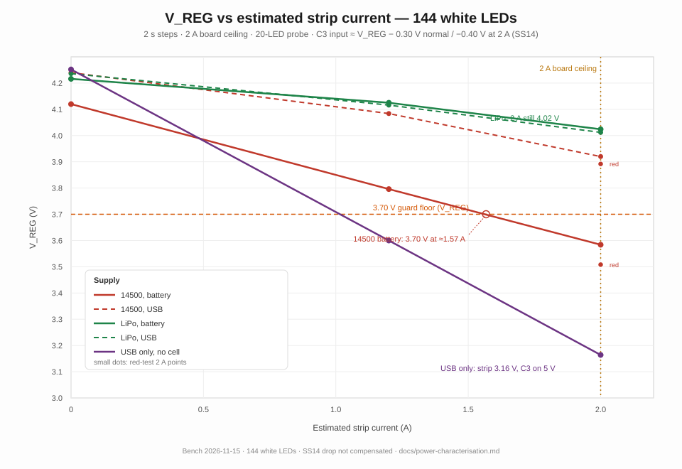

# Power characterisation — 144 white LEDs at the 2 A ceiling

**Bench:** 2026-11-15, Lux et Portabilis V2 (ESP32-C3 SuperMini, 144 × WS2812B), SS14 from
V_REG to the module's 5 V pin.
**Firmware:** `0.5.0-dev` + the stress test / safe-mode build.
**Purpose:** derive the 0.6 strip budget, guard floor, suggested limit and safe-mode behaviour
from measured V_REG under load.

---

## 1. Method

- `@STRESS white` on 144 LEDs, 2 s per +5 brightness step (the precise reference;
  the fast default is now 500 ms), 2 A model ceiling (3 A / 4 A test-only
  selectable), 20-LED probe, 5 s unplug window. Every step is written to NVS
  before it is applied.
- V_REG is the **battery rail**, upstream of D1. The C3 input is one SS14 drop below it:
  ~0.30 V at normal loads, ~0.40 V at 2 A. The forced-brown-out run will pin the drop at collapse.
- "USB" means the cable was attached and the cell was present, so the TP4056 contributes up to
  ~500 mA and the cell supplies the rest. "USB only" is the spin-off with **no cell**: the C3 runs
  from USB 5 V, the strip from the TP4056 BAT node.
- The earlier red 144 runs are kept as a colour cross-check (0.4 A probe; the white probe is 1.2 A).
- A separate `@SENSE N [burst]` lights **1–100 white LEDs at full brightness** for 200 ms or 2 s
  after the same 5 s window. It is the quick channel-resistance linearity sweep, decoupled from the
  stress ramp; the current is the 60 mA/LED model, so R drifting with N is the cell/model effect.

## 2. Results

| Supply (144 white) | V_start | V @ probe | V @ 2 A | R probe | R @ 2 A | C3 input @ 2 A |
|---|---:|---:|---:|---:|---:|---:|
| 14500, battery | 4120 | 3796 @1.2 A | **3584** | 270 mΩ | 268 mΩ | ~3.18 V |
| 14500, USB | 4240 | 4084 @1.2 A | 3920 | 130 mΩ | 160 mΩ | ~3.52 V |
| LiPo drone, battery | 4216 | 4125 @1.2 A | **4024** | 76 mΩ | 96 mΩ | ~3.62 V |
| LiPo drone, USB | 4236 | 4116 @1.2 A | 4012 | 100 mΩ | 112 mΩ | ~3.61 V |
| USB only, no cell | 4252 | 3600 @1.2 A | 3164 | 543 mΩ | 544 mΩ | C3 on 5 V; strip 3.16 V |

Colour cross-check, 14500 (red, 0.4 A probe):

| Supply | V_start | V @ 0.4 A | V @ 2 A | R probe | R @ 2 A |
|---|---:|---:|---:|---:|---:|
| 14500 red, battery | 4156 | 4028 | **3508** | 320 mΩ | 324 mΩ |
| 14500 red, USB | 4240 | 4196 | 3892 | 110 mΩ | 174 mΩ |

The red and white points at 2 A differ by cell state/source resistance, not by colour; the
brightness at which 2 A is reached is 177/255 for red and 59/255 for white.

### Lab high-current (test-only)

| Supply (144 white) | Load | V_start | V at load | Sag | R probe | R at load | Result |
|---|---|---:|---:|---:|---:|---:|---|
| LiPo drone, battery | 4 A, 500 ms | 4168 | **3732** | 436 | 140 mΩ | 109 mΩ | 4 A ceiling; no brown-out; 32 mV above floor |
| LiPo drone, battery | 4 A, **2 s** | 4156 | **3704** | 452 | 140 mΩ | 113 mΩ | 4 A ceiling; no brown-out; **4 mV above floor** |
| 14500, USB | 4 A, 500 ms | 4248 | **3648** | 600 | 150 mΩ | 150 mΩ | 4 A ceiling; no collapse; **52 mV below floor** |
| 14500, battery | 4 A, 500 ms | 4116 | **3308** | 808 | 270 mΩ | 202 mΩ | 4 A ceiling; no collapse; **392 mV below floor**, C3 ~2.86 V |
| 14500, battery | **5 A, 500 ms, no rail** | 4152 | **3208** | 944 | 280 mΩ | 189 mΩ | 5 A ceiling; no collapse; **C3 ~2.76 V**, 147/255 |
| USB only, no cell | 4 A, 500 ms, **no rail** | 4228 | **1988** | 2240 | 553 mΩ | — | 4 A ceiling; rail 1.988 V; C3 on 5 V only |

The LiPo at 4 A did not collapse at either step: 3732 mV at 500 ms and **3704 mV at the precise
2 s** — 4 mV above the 3.70 V floor, with the C3 input around 3.30 V. The 28 mV difference is cell
polarization, not the ADC: the 500 ms point is the fast scan, the 2 s point is the reference.

The **14500 with USB** also reaches 4 A without collapsing, but at **3648 mV** — 52 mV **below**
the floor. The charger supplies ~500 mA and the cell the rest; the C3 survived at ~3.25 V, but this
is already in the region the guard would derate.

The **14500 battery-only** 4 A is the worst cell point of the ladder: **3308 mV**, 392 mV below the
floor, C3 input ~2.86 V. It still did not collapse — the C3's actual threshold is lower than the
3.70 V guard floor — but it is far outside any normal operating point.

The **14500 battery-only 5 A, rail guard off** run (144 white, 500 ms) reaches **3208 mV**
(sag 944 mV, R 280 mΩ, 147/255, 4980 mA) and the C3 **still survives** at ~2.76 V at the module.
So the C3's actual brown-out threshold is **below ~2.76 V**; the 3.70 V floor is a conservative
guard, not the C3's limit. 5 A is the PMOS maximum and a 500 ms pulse within the 20 A rating.

The **no-battery 4 A, rail guard off** run reaches **1988 mV** (sag 2240 mV) and the C3 still
survives **only because it is on USB 5 V**. That is the strip/TP4056 rail collapsing, not the C3;
it says nothing about the C3's brown-out threshold and must not be read as the C3 tolerating 1.988 V.

The ceiling now allows **6 A**, but by decision the 6 A runs are not taken: **60 LEDs / 3.6 A** is
the PMOS continuous point and is enough to settle the model. The 144 white at 6 A would be
177/255; the 14500 ~2.5 V and the LiPo ~3.32 V, both already covered by the 4 A / 3.6 A data.

The **no-battery USB** attempt shows the rail guard doing its job: 550 mΩ, the run stopped at
**2.71 A / 2968 mV**, result “rail collapsed”. The C3 is on USB 5 V and cannot brown out, so the
3.0 V floor is what ends the test before the absolute limit. Setting the **rail floor to 0**
(“No rail guard” on the console) is the lab path past it; the 14500 battery at 6 A is the run most
likely to brown the C3. The 3.70 V normal guard and the 10 Hz guard are separate and unaffected.

### Channel resistance sweep (standalone `@SENSE`)

The sense run is decoupled from the ramp: N white LEDs at full brightness, one burst, 5 s
cable-removal window.

| Supply | LEDs | Model I | Burst | V_off | V_lit | Drop | R |
|---|---:|---:|---:|---:|---:|---:|---:|
| USB only | 20 | 1200 mA | 200 ms | 4252 | 3592 | 660 | 550 mΩ |
| USB only | 50 | 3000 mA | 200 ms | 4216 | 2892 | 1324 | **441 mΩ** |
| USB only | 60 | 3600 mA | 200 ms | 4224 | 2836 | 1388 | **385 mΩ** |
| USB only | 100 | 6000 mA | 200 ms | — | — | — | not run (decision) |
| 14500, battery | 50 | 3000 mA | 200 ms | 4208 | 3784 | 424 | **141 mΩ** |
| 14500, battery | 50 | 3000 mA | 2 s | 4208 | 3756 | 452 | **150 mΩ** |
| 14500, battery | 60 | 3600 mA | 200 ms | 4160 | 3424 | 736 | **204 mΩ** |
| 14500, battery | 100 | 6000 mA | 200 ms | — | — | — | not run (decision) |
| LiPo, battery | 60 | 3600 mA | 200 ms | 4020 | 3592 | 428 | **118 mΩ** |

The first row is the stress-test probe (1.2 A), the second is `@SENSE 50 200`. The no-battery path
drops from **550 mΩ at 1.2 A to 441 mΩ at 3 A and 385 mΩ at 3.6 A** — the rail is not linear; this
is the TP4056/rail plateau, not a cell. The model current is 60 mA/LED, so at 2.836 V the real
WS2812B current is well below 3.6 A and these are *model* resistances.

The **60-LED / 3.6 A** row is the PMOS continuous rating: 3424 mV on the 14500, 3592 mV on the LiPo
(but from a lower V_start 4020), 2836 mV on no battery. On the 14500 the 3 A point is 3784 mV from
a fuller cell (4208), the 3.6 A point 3424 mV (4160) and the 4 A point 3308 mV (4116); R is
141 / 204 / 202 mΩ, so the cell-state spread dominates the apparent “R”. The 100-LED / 6 A row is
not run by decision: 60 LEDs / 3.6 A is the PMOS continuous point and is enough for the model.

## 3. Graph



## 4. Findings

1. **The 14500 on battery is the limiting case.** 270–320 mΩ; at 2 A the rail is 3.51–3.58 V,
   which is 120–190 mV **below** the proposed 3.70 V floor. The safe continuous current at
   3.70 V is `(4120 − 3700) / 0.270 ≈ 1.56 A` (white) and `(4156 − 3700) / 0.320 ≈ 1.43 A` (red).
   Use **1.4 A** as the conservative suggestion. At 4 A it reaches **3308 mV** (392 mV below the
   floor) and the C3 still survived; the 3.70 V floor is a conservative guard, not the C3's
   actual threshold.
2. **The LiPo is not the limiting cell at 2 A.** 76–156 mΩ; at 2 A it is 3.82–4.02 V, above the
   floor. At 4 A it is **3732 mV at 500 ms and 3704 mV at the 2 s precise** — 4 mV above the floor,
   still no collapse — so the 2 A and 4 A ceilings are the **board**, not the cell. The LiPo is
   comfortable at 2 A and sits right on the guard floor at the 4 A lab ceiling.
3. **USB with a cell helps the 14500 a lot** (3920 vs 3584 mV at 2 A) because the TP4056 supplies
   ~500 mA and unloads the weak cell. At 4 A the USB-assisted 14500 is **3648 mV**, 52 mV below the
   floor but still no collapse; the battery-only 4 A is the run expected to collapse near 2.9 V.
   It helps the LiPo only slightly (4012 vs 4024 mV at 2 A).
4. **USB only is not a 2 A source.** 543 mΩ is the TP4056/cable/Q3 path; the strip's rail collapses
   to 3.16 V, the actual LED current is below the model, and only the C3 survives because it is on
   USB 5 V. Treat this as the V_USB-path reference, not as a product configuration.
5. **Colour does not change the current limit.** At the same 2 A the red and white rails are within
   the cell-state spread; the colour changes the brightness at which 2 A is reached, not the limit.
6. **The SS14 drop matters.** A 3.70 V V_REG floor leaves ~3.30 V at the module at 2 A (0.40 V
   drop), which is the right conservative reading. The 0.30 V normal-load figure is fine at 1 A.
7. **The default 1000 mA is safe on every supply tested**: 1 A puts the 14500 battery at ~3.84 V
   and the LiPo at ~4.05 V. The 2000 mA field is usable only with the guard; 70% of 2000
   (1400 mA) sits at the 3.70 V floor on the 14500 and is comfortable on the LiPo.
8. **60 LEDs / 3.6 A is the PMOS continuous point** and closes the sweep: 14500 **3424 mV**
   (R 204), LiPo **3592 mV** (R 118, V_start 4020), no battery **2836 mV** (R 385). The 14500
   3.6 A is 246 mV below the floor; the 3 A 3784 mV (fuller cell) and 4 A 3308 mV show the
   cell-state spread, not a constant R. The 14500 **5 A / no rail** run reaches **3208 mV**
   (C3 ~2.76 V) and survives, so the C3 threshold is below ~2.76 V and the 3.70 floor is
   conservative. The no-battery 4 A / 1988 mV is the strip rail with the C3 on USB 5 V, not
   evidence about the C3. The 6 A runs are not taken by decision.

## 5. Safe current and suggested budget

| Supply | R @ 2 A | Safe at 3.70 V | Suggested strip budget |
|---|---:|---:|---:|
| 14500, battery | 268–324 mΩ | 1.4–1.6 A | **1400 mA** |
| 14500, USB | 160–174 mΩ | 3.1–3.4 A | 2000 mA (ceiling) |
| LiPo, battery | 96 mΩ | 5.4 A | 2000 mA (ceiling) |
| LiPo, USB | 112 mΩ | 4.8 A | 2000 mA (ceiling) |
| USB only | 544 mΩ | ~1.0 A (strip) | not a product; do not suggest |

The page should show this as an **advisory** line from the last **battery-only** test:

```
suggested ≈ (V_start − 3.70 V) / R_at_2A      (clamped to 100–2000 mA)
```

It must not write the user's field. The 10 Hz guard remains the enforcement, and the 70% safe
value remains the recovery. The test record should carry a **battery / USB** flag so a USB probe
cannot produce a too-optimistic suggestion.

## 6. 0.6 constants derived here

| Constant | Value | Source |
|---|---|---|
| Guard floor | **3.70 V V_REG** | 14500 2 A at 3.58 V; C3 input ~3.18 V |
| Default strip budget | **1000 mA** | safe on all tested supplies |
| Normal maximum | **2000 mA** | board/wire benchmark |
| Test-only ceiling | **500–6000 mA (default 2000)** | lab forced-brown-out; 500 ms fast, 2 s precise |
| Test rail floor | **3000 mV default; 0 = ignore** | test safety for the USB-powered C3; 0 is lab-only |
| PMOS limit | **3.6 A continuous / 5 A max / 20 A pulses** | LCSC C42456992; 60 white LEDs = 3.6 A |
| Safe-mode fraction | **70%** | user decision |
| MCU reserve | **200 mA** | fixed budget headroom |
| LED model | **20 mA per selected channel** | 144 white (7) 59/255 = 2 A; the mask follows popcount |
| Step time | **2 s precise / 500 ms fast** | RC τ 7.5 ms; 500 ms = 66 τ |
| SS14 drop | **0.30 V normal / 0.40–0.45 V at 2–4 A** | measured rail vs module input |

## 7. Caveats and open items

- **The high-current ladder is complete, and no run collapsed.** The worst cell point is the 14500
  battery-only 5 A at **3208 mV** (sag 944 mV, C3 input ~2.76 V), and the C3 still survived. So the
  3.70 V floor is **conservative**, not the C3's actual brown-out threshold; the threshold is below
  ~2.76 V and was not reached. 5 A is the PMOS max (500 ms pulse); the 6 A runs are not taken. The
  2 A continuous benchmark applies.
- **The no-battery 1.988 V is NOT the C3's tolerance.** The C3 was on USB 5 V; only the strip/TP4056
  rail collapsed. It is the useful end of the no-battery path, not evidence about the C3 threshold.
- **The SS14 drop at collapse could not be measured** because nothing collapsed even at 5 A. The C3
  survived ~2.76 V at its input, so the 0.40–0.45 V estimate is consistent but the collapse point
  remains unknown.
- **500 ms vs 2 s:** the RC is 7.5 ms, so 500 ms is stable; the LiPo 4 A shows **28 mV** between
  the two (3732 vs 3704), which is cell polarization, not the ADC. The 2 s points are the precise
  reference; the 500 ms points are the fast scan.
- **10 white was skipped by decision.** Full 255 at ~0.6 A is safe on every supply; it cannot
  force a brown-out on a healthy cell.
- **The no-battery USB 2 A point is a model point**, not a measured 2 A: the strip's actual current
  at 3.16 V is lower. It is useful only as the V_USB-path shape.
- **COM9 after a battery run:** the self-powered C3 USB Serial/JTAG does not re-enumerate after a
  cable replug; press RESET (or power-cycle) once, then connect. The result is in NVS.
- The safe-mode warning now has a 5 s acknowledgement timeout so the console can always connect
  and clear it; a stuck-high pad cannot wedge the boot.

## 8. Test procedure (for the next runs)

1. Shared page → LED count 144; radio off.
2. Diagnostics → R/G/B channels (mixed colours allowed), limit 500–6000 mA, Fast
   (500 ms) or unchecked (2 s precise) → **Run test**. The console builds the
   `@STRESS` line; nothing is typed.
3. Start; the strip blanks for 5 s → unplug for a battery test, or leave it for USB.
4. Reconnect; the result is in NVS. If COM9 is missing, press RESET once.
5. Clear safe mode separately with **Clear safe mode** (or 5-click power-off).
6. Record: supply (battery/USB/no-cell), channel mask, limit, step, V_start,
   V_min, sag, R, brightness, est mA, result.
7. Channel resistance: run **Sense** at 1, 10, 20, 50 and 100 LEDs with 200 ms
   bursts (2 s is the lab precise point); record V_off, V_on, model mA and R. R
   drifting with count is the cell/model linearity; 100 LEDs / 2 s is above the
   PMOS continuous rating.
8. The touch pad is blanked for **1 s after every stress/sense test** to reject
   the load-transient false press; do not press modes during that second. GPIO9
   stays live.
